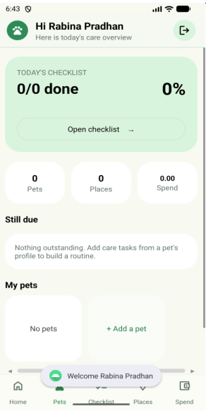
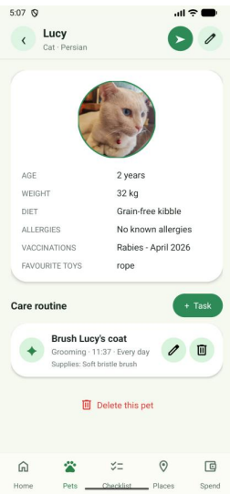
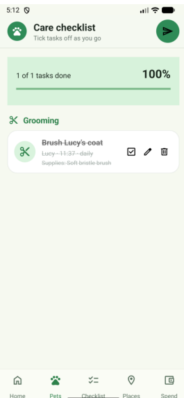
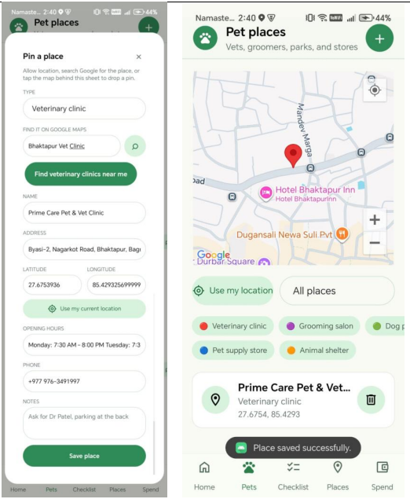
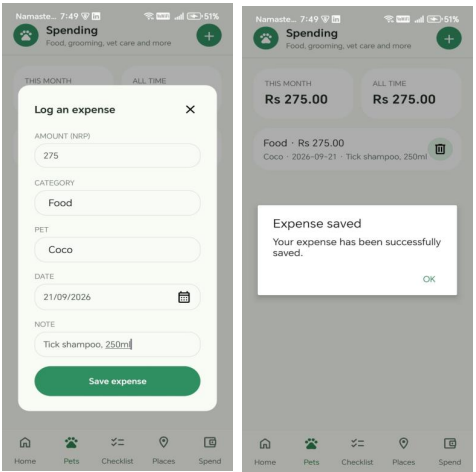

# 🐾 PetCare – Pet Management Android Application
PetCare is an Android application designed to help pet owners manage their pets' daily care activities in one place. It provides tools for managing pet profiles, organizing care tasks, tracking expenses, and discovering nearby pet-related places.
The application aims to make everyday pet care more organized, convenient, and manageable. This was my final year university project for Android Mobile Development Course.

## 📱 Screenshots

<!-- Add your application screenshots to a screenshots/ folder -->

### Dashboard


### Pet Management


### Task Management


### Nearby Places


### Expense Tracking


---

## ✨Features
### 1. User Authentication
- User registration and login.
- Password hashing.
- Local user data management.
- User-specific application data.

### 2. Pet Profile Management
- Add and manage multiple pets.
- Edit and delete pet profiles.
- Store pet information, including:
  - Name
  - Species
  - Breed
  - Age
  - Weight
  - Dietary preferences
  - Allergies
  - Vaccination history
  - Favourite toys
  - Additional notes
- Upload pet photos using the camera or gallery.

### 3. Pet Care Task Management
- Create and manage pet care tasks.
- Organize tasks by category:
  - Feeding
  - Exercise
  - Grooming
  - Healthcare
  - Medication
- Set task dates and times.
- Add supplies and additional notes.
- Edit and delete tasks.

### 4. Daily Care Checklist
- View scheduled tasks for the day.
- Track completed and pending tasks.
- Mark tasks as completed.
- Organize daily activities by category.
- Share selected care tasks with another person through SMS.

### 5. Nearby Pet-Friendly Places
- Discover nearby places using Google Maps and Places APIs.
- Search for relevant locations.
- View locations on an interactive map.
- Access location information and manage saved places.

### 6. Pet Expense Tracking
- Record pet-related expenses.
- Associate expenses with individual pets.
- View expense history.
- Calculate monthly and overall spending.
- Delete expense records.

### 7. Dashboard
- View an overview of registered pets.
- Monitor daily care activities.
- See pending tasks.
- Access pet management, checklist, nearby places, and spending sections.

---
## Tech Stack
- Kotlin -> Primary programming language
- Android Studio -> Development environment 
- XML -> UI layouts
- Android SDK -> Native Android development
- Room Database -> Local database management
- SQLite -> Local data storage 
- MVVM -> ViewModel-based application architecture
- Kotlin Coroutines -> Asynchronous operations
- Kotlin Flow -> Reactive data observation
- Google Maps SDK -> Interactive maps 
- Google Places API -> Nearby places discovery
- Google Location Services -> Device location access 
- Material Components -> UI components
-  Gradle -> Build automation 

---

## Project Architecture

The project follows a layered structure using Activities, ViewModels, Repositories, DAOs, and Room Database.

```text
PetCare/
│
├── app/
│   └── src/
│       └── main/
│           │
│           ├── java/com/example/petcare/
│           │   │
│           │   ├── data/
│           │   │   ├── dao/
│           │   │   ├── database/
│           │   │   ├── entity/
│           │   │   └── repository/
│           │   │
│           │   ├── ui/
│           │   │   └── auth/
│           │   │
│           │   ├── viewmodel/
│           │   │
│           │   ├── utils/
│           │   │
│           │   ├── MainActivity.kt
│           │   ├── DashboardActivity.kt
│           │   ├── PetsActivity.kt
│           │   ├── ChecklistActivity.kt
│           │   ├── PlacesActivity.kt
│           │   └── SpendingActivity.kt
│           │
│           ├── res/
│           │   ├── drawable/
│           │   ├── layout/
│           │   ├── mipmap/
│           │   └── values/
│           │
│           └── AndroidManifest.xml
│
├── gradle/
├── build.gradle.kts
├── settings.gradle.kts
└── README.md
```

### Database Design

PetCare uses Room as its local database persistence layer.

The database contains five primary entities:

| Entity | Description |
|---|---|
| User | Stores user account information |
| Pet | Stores pet profiles and personal details |
| Task | Stores pet care activities and completion status |
| Place | Stores saved places |
| Expense | Stores pet-related spending records |

Database operations are organized through DAO interfaces and repositories.

---

## 🚀 Getting Started

### Prerequisites

Before running the application, make sure you have:

- Android Studio
- Android SDK
- JDK 17 or compatible Android Studio Gradle JDK
- Android emulator or physical Android device
- Google Maps API key
- Google Places API access

### 1. Clone the Repository

```bash
git clone hhttps://github.com/rabinapradhan/petCare.git
```

### 2. Open the Project

1. Open Android Studio.
2. Select **Open Project**.
3. Choose the cloned PetCare directory.
4. Allow Gradle to synchronize dependencies.

### 3. Configure Google Maps API Key

Create a `secrets.properties` file in the `app` directory.

Add your own API key:

```properties
MAPS_API_KEY=YOUR_GOOGLE_MAPS_API_KEY
PLACES_API_KEY=YOUR_GOOGLE_PLACES_API_KEY
```

Enable the required Google Maps, Places, and location-related APIs in Google Cloud Console.

Restrict your API key appropriately and never commit secret credentials to GitHub.

### 4. Run the Application

1. Connect an Android device or start an emulator.
2. Select the app configuration.
3. Click **Run** in Android Studio.

---

## Permissions
The application uses the following Android permissions:

- Internet access – Google Maps and Places integration.
- Fine and coarse location – Location-based functionality.
- Camera – Capturing pet photos.

Camera access is optional because users can also select photos from their gallery.

---

##  Project Objectives
- Develop a native Android application using Kotlin.
- Implement local database management using Room.
- Apply repository and ViewModel-based architecture.
- Implement CRUD operations for pets, tasks, places, and expenses.
- Integrate Google Maps and Places APIs.
- Work with Android permissions and device capabilities.
- Build a practical application that addresses everyday pet care management needs.

---

## Future Improvements
- Push notifications and scheduled task reminders.
- Veterinary appointment management.
- Pet health record tracking.
- Cloud synchronization and backup.
- Online authentication and multi-device support.
- Enhanced analytics for pet expenses.

---

## Author
Rabina Pradhan


---

⭐ If you find this project interesting, consider giving the repository a star!
